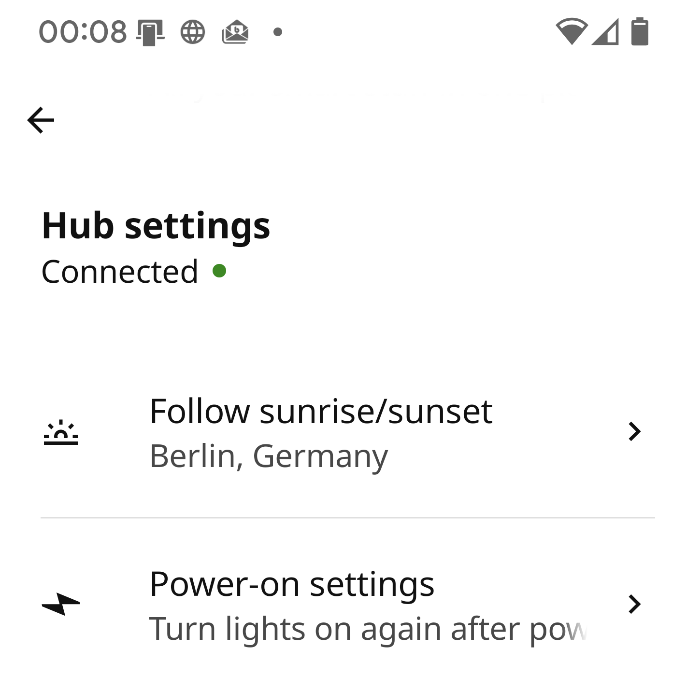
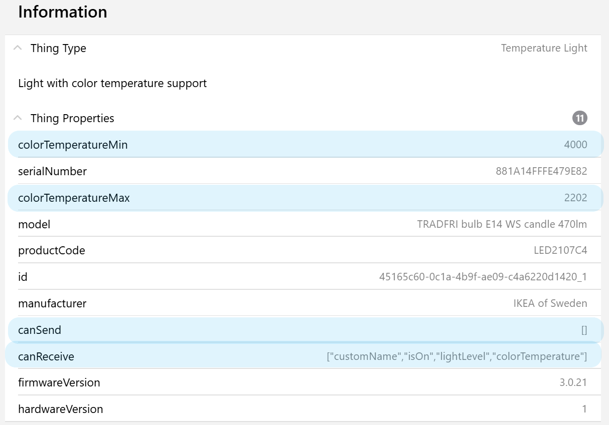
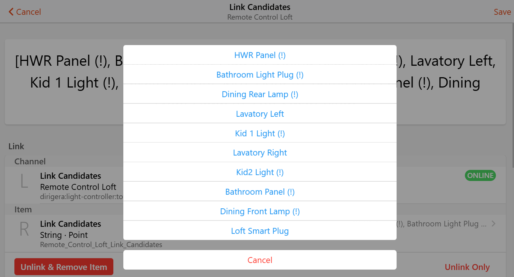
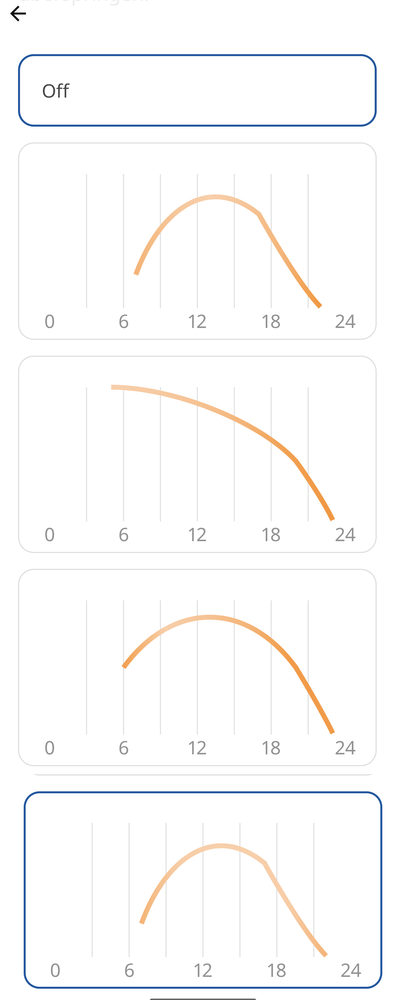

# DIRIGERA Binding

Binding supporting the DIRIGERA Gateway from IKEA.

## Supported Things

The DIRIGERA `bridge` is providing the connection to all devices and scenes.

Refer to below sections which devices are supported and are covered by `things` connected to the DIRIGERA bridge.

| ThingTypeUID          | Description                                                | Section                                   | Products                                  |
|-----------------------|------------------------------------------------------------|-------------------------------------------|-------------------------------------------|
| `gateway`             | IKEA Gateway for smart products                            | [Gateway](#gateway-channels)              | DIRIGERA                                  |
| `air-purifier`        | Air cleaning device with particle filter                   | [Air Purifier](#air-purifier)             | STARKVIND                                 |
| `air-quality`         | Air measure for temperature, humidity and particles        | [Sensors](#air-quality-sensor)            | VINDSTYRKA                                |
| `blind`               | Window or door blind                                       | [Blinds](#blinds)                         | PRAKTLYSING ,KADRILJ ,FRYKTUR, TREDANSEN  |
| `blind-controller`    | Controller to open and close blinds                        | [Controller](#blind-controller)           | TRÅDFRI                                   |
| `switch-light`        | Light with switch ON, OFF capability                       | [Lights](#switch-lights)                  | TRÅDFRI                                   |
| `dimmable-light`      | Light with brightness support                              | [Lights](#dimmable-lights)                | TRÅDFRI                                   |
| `temperature-light`   | Light with color temperature support                       | [Lights](#temperature-lights)             | TRÅDFRI, FLOALT                           |
| `color-light`         | Light with color support                                   | [Lights](#color-lights)                   | TRÅDFRI, ORMANÅS                          |
| `light-set`           | Group of lights controlled as one logical unit             | [Lights](#light-set)                      | Set of lights which are handled together  |
| `light-controller`    | Controller to handle light attributes                      | [Controller](#light-controller)           | TRÅDFRI, RODRET,STYRBAAR                  |
| `motion-sensor`       | Sensor detecting motion events                             | [Sensors](#motion-sensor)                 | TRÅDFRI                                   |
| `motion-light-sensor` | Sensor detecting motion events and measures light level    | [Sensors](#motion-light-sensor)           | VALLHORN                                  |
| `single-shortcut`     | Shortcut controller with one button                        | [Controller](#single-shortcut-controller) | TRÅDFRI                                   |
| `double-shortcut`     | Shortcut controller with two buttons                       | [Controller](#double-shortcut-controller) | SOMRIG                                    |
| `simple-plug`         | Power plug                                                 | [Plugs](#simple-plug)                     | TRÅDFRI, ÅSKVÄDER                         |
| `power-plug`          | Power plug with status light and child lock                | [Plugs](#power-plug)                      | TRETAKT                                   |
| `smart-plug`          | Power plug with electricity measurements                   | [Plugs](#smart-power-plug)                | INSPELNING                                |
| `speaker`             | Speaker with player activities                             | [Speaker](#speaker)                       | SYMFONISK                                 |
| `sound-controller`    | Controller for speakers                                    | [Controller](#sound-controller)           | SYMFONISK, TRÅDFRI                        |
| `contact-sensor`      | Sensor tracking if windows or doors are open               | [Sensors](#contact-sensor)                | PARASOLL                                  |
| `water-sensor`        | Sensor to detect water leaks                               | [Sensors](#water-sensor)                  | BADRING                                   |
| `repeater`            | Repeater to strengthen signal                              | [Repeater](#repeater)                     | TRÅDFRI                                   |
| `scene`               | Scene from IKEA Home smart app which can be triggered      | [Scenes](#scenes)                         | -                                         |

New products are based on Matter standard.
If they are paired with the DIRIGERA gateway via IKEA home smart App they can be integrated with the following things.
Each thing depends on the underlying hardware and channels are created based on the delivered values, e.g.

- `ota` channels for devices which can receive updates
- `battery` channels for battery powered devices
- `link` channels if device can be linked to a controller or sensor
- `startup` channel if device _power on_ behavior can be configured

Examples are MYGGSPRAY as `occupancy-sensor` which also provides a `light-sensor` or TIMMERFLOTTE as `environment-sensor` delivers temperature and humidity while ALPSTUGA also measures CO2 and particulate matter.

| ThingTypeUID          | Description                                               | Section                                   | Products                                  |
|-----------------------|-----------------------------------------------------------|-------------------------------------------|-------------------------------------------|
| `occupancy-sensor`    | Sensor to detect presence of people                       | [Sensors](#occupancy-sensor)              | MYGGSPRAY                                 |
| `light-sensor`        | Sensor providing illuminance measures                     | [Sensors](#light-sensor)                  | included in MYGGSPRAY                     |
| `environment-sensor`  | Sensor measuring temperature, humidity and air quality    | [Sensors](#environment-sensor)            | TIMMERFLOTTE, ALPSTUGA                    |
| `open-close-sensor`   | Sensor detecting open/closed doors, windows or drawers    | [Sensors](#open-close-sensor)             | MYGGBETT                                  |
| `water-leak-sensor`   | Sensor detecting water leaks                              | [Sensors](#water-leak-sensor)             | KLIPPBOK                                  |
| `two-button-switch`   | Controller with 2 programmable buttons                    | [Controller](#two-button-switch)          | BILRESA dual button                       |
| `three-button-switch` | Controller with 3 programmable buttons                    | [Controller](#three-button-switch)        | BILRESA scroll wheel                      |
| `matter-light`        | LED light (based on Matter standard)                      | [Lights](#matter-light)                   | KAJPLATS series                           |
| `matter-outlet`       | Power plug with electricity measurements                  | [Plugs](#smart-power-plug-matter)         | GRILLPLATS, TOFSMYGGA                     |

## Discovery

The discovery will automatically detect your DIRIGERA Gateway via mDNS.
If it cannot be found check your router for IP address.
Manual scan isn't supported.

After successful creation of DIRIGERA Gateway and pairing process connected devices are automatically added to your INBOX.
You can switch off the automatic detection in [Bridge configuration](#bridge-configuration).

**Before adding the bridge** read [Pairing section](#gateway-pairing).

Devices connected to this bridge will be detected automatically unless you don't switch it off in [Bridge Configuration](#bridge-configuration)

## Gateway Bridge

### Bridge Configuration

| Name            | Type    | Description                                                | Explanation                                                                          | Default | Required |
|-----------------|---------|------------------------------------------------------------|--------------------------------------------------------------------------------------|---------|----------|
| `ipAddress`     | text    | DIRIGERA IP Address                                        | Use discovery to obtain this value automatically or enter it manually if known       | N/A     | yes      |
| `id`            | text    | Unique id of this gateway                                  | Detected automatically after successful pairing                                      | N/A     | no       |
| `discovery`     | boolean | Configure if paired devices shall be detected by discovery | Run continuously in the background and detect new, deleted or changed devices        | true    | no       |

### Gateway Pairing

First setup requires pairing the DIRIGERA gateway with openHAB.
You need physical access to the gateway to finish pairing so ensure you can reach it quickly.

Let's start pairing

1. Add the bridge found in discovery
1. Pairing started automatically after creation!
1. Press the button on the DIRIGERA rear side
1. Your bridge shall switch to ONLINE

### Gateway Channels

| Channel         | Type      | Read/Write | Description                                  |
|-----------------|-----------|------------|----------------------------------------------|
| `pairing`       | Switch    | RW         | Sets DIRIGERA hub into pairing mode          |
| `location`      | Location  | R(W)       | Location in lat.,lon. coordinates            |
| `sunrise`       | DateTime  | R          | Date and time of next sunrise                |
| `sunset`        | DateTime  | R          | Date and time of next sunset                 |
| `statistics`    | String    | R          | Several statistics about gateway activities  |

Channel `location` can overwrite GPS position with openHAB location, but it's not possible to delete GPS data.
See [Gateway Limitations](#gateway-limitations) for further information.

### Follow Sun



[Motion Sensors](#motion-sensor) can be active all the time or follow a schedule.
One schedule is follow the sun which needs to be activated in the IKEA Home smart app in _Hub Settings_.

## Things

With [DIRIGERA Gateway Bridge](#gateway-bridge) in place things can be connected as mentioned in the [supported things section](#supported-things).
Things contain generic configuration, properties and channels according to their capabilities.

### Generic Thing Configuration

Each thing is identified by a unique id which is mandatory to configure.
Discovery will automatically identify the id.

| Name              | Type    | Description                         | Default | Required |
|-------------------|---------|-------------------------------------|---------|----------|
| `id`              | text    | Unique id of this device / scene    | N/A     | yes      |

### Generic Thing Properties

Each thing has properties attached for product information.
It contains information of hardware and firmware version, device model and manufacturer.
Device capabilities are listed in `canReceive` and `canSend`.



### Generic Thing Channels

#### OTA Channels

Over-the-Air (OTA) updates are common for many devices.
If device is providing these channels is detected during runtime.

| Channel         | Type      | Read/Write | Description                                  | Advanced |
|-----------------|-----------|------------|----------------------------------------------|----------|
| `ota-status`    | Number    | R          | Over-the-air overall status                  |          |
| `ota-state`     | Number    | R          | Over-the-air current state                   |    X     |
| `ota-progress`  | Number    | R          | Over-the-air current progress                |    X     |

`ota-status` shows the _overall status_ if your device is _up to date_ or an _update is available_.
`ota-state` and `ota-progress` shows more detailed information which you may want to follow, that's why they are declared as advanced channels.

#### OTA Mappings

Mappings for `ota-status`

- 0 : Up to date
- 1 : Update available

Mappings for `ota-state`

- 0 : Ready to check
- 1 : Check in progress
- 2 : Ready to download
- 3 : Download in progress
- 4 : Update in progress
- 5 : Update failed
- 6 : Ready to update
- 7 : Check failed
- 8 : Download failed
- 9 : Update complete
- 10 : Battery check failed

#### Links and Candidates

Devices can be connected directly e.g. sensors or controllers with lights, plugs, blinds or speakers.
It's detected during runtime if a device is capable to support links _and_ if devices are available in your system to support this connection.
The channels are declared advanced and can be used for setup procedure.

| Channel               | Type                  | Read/Write | Description                                      | Advanced |
|-----------------------|-----------------------|------------|--------------------------------------------------|----------|
| `links`               | String                | RW         | Linked controllers, sensors and devices          |    X     |
| `link-candidates`     | String                | RW         | Candidates which can be linked                   |    X     |



Several devices can be linked together like

- [Light Controller](#light-controller) and [Motion Sensors](#motion-sensor) to [Plugs](#power-plugs) and [Lights](#lights)
- [Blind Controller](#blind-controller) to [Blinds](#blinds)
- [Sound Controller](#sound-controller) to [Speakers](#speaker)

Established links are shown in channel `links`.
The linked devices can be clicked in the UI and the link will be removed.

Possible candidates to be linked are shown in channel `link-candidates`.
If a candidate is clicked in the UI the link will be established.

Candidates and links marked with `(!)` are not present in openHAB environment so no handler is created yet.
In this case it's possible not all links are shown in the UI, but the present ones shall work.

#### Other Channels

| Channel               | Type              | Read/Write | Description                                  |
|-----------------------|-------------------|------------|----------------------------------------------|
| `startup`             | Number            | RW         | Startup behavior after power cutoff          |
| `custom-name`         | String            | RW         | Name given from IKEA home smart app          |

`startup` defines how the device shall behave after a power cutoff.
If there's a dedicated hardwired light switch which cuts power towards the bulb it makes sense to switch them on every time the switch is pressed.
But it's also possible to recover the last state.

Mappings for `startup`

- 0 : Previous
- 1 : On
- 2 : Off
- 3 : Switch

Option 3 is offered in IKEA Home smart app to control lights with using your normal light switch _slowly and smooth_.
With this the light shall stay online.
I wasn't able to reproduce this behavior.
Maybe somebody has more success.

`custom-name` is declared e.g. in your IKEA Home smart app.
This name is reflected in the discovery and if thing is created this name will be the thing label.
If `custom-name` is changed via openHAB API or a rule the label will not change.

### Unknown Devices

Filter your traces regarding 'DIRIGERA MODEL Unsupported Device'.
The trace contains a JSON object at the end which is needed to implement a corresponding handler.

## Air Purifier

Air cleaning device with particle filter.

| Channel               | Type              | Read/Write | Description                                  |
|-----------------------|-------------------|------------|----------------------------------------------|
| `fan-mode`            | Number            | RW         | Fan on, off, speed or automatic behavior     |
| `fan-speed`           | Dimmer            | RW         | Manual regulation of fan speed               |
| `fan-runtime`         | Number:Time       | R          | Fan runtime in minutes                       |
| `filter-elapsed`      | Number:Time       | R          | Filter elapsed time in minutes               |
| `filter-remain`       | Number:Time       | R          | Time to filter replacement in minutes        |
| `filter-lifetime`     | Number:Time       | R          | Filter lifetime in minutes                   |
| `filter-alarm`        | Switch            | R          | Filter alarm signal                          |
| `particulate-matter`  | Number:Density    | R          | Category 2.5 particulate matter              |
| `disable-status-light`| Switch            | RW         | Disable status light on plug                 |
| `child-lock`          | Switch            | RW         | Child lock for button on plug                |

There are several `Number:Time` which are delivered in minutes as default.
Note you can change the unit when connecting an item e.g. to `d` (days) for readability.
So you can check in a rule if your remaining filter time is going below 7 days instead of calculating minutes.

### Air Purifier Channel Mappings

Mappings for `fan-mode`

- 0 : Auto
- 1 : Low
- 2 : Medium
- 3 : High
- 4 : On
- 5 : Off

## Blinds

Window or door blind.

| Channel               | Type                  | Read/Write | Description                                      |
|-----------------------|-----------------------|------------|--------------------------------------------------|
| `blind-state`         | Number                | RW         | State if blind is moving up, down or stopped     |
| `blind-level`         | Dimmer                | RW         | Current blind level                              |
| `battery-level`       | Number:Dimensionless  | R          | Battery charge level in percent                  |

### Blind Channel Mappings

Mappings for `blind-state`

- 0 : Stopped
- 1 : Up
- 2 : Down

## Lights

Light devices in several variants.
Can be light bulbs, LED stripes, remote driver and more.
Configuration contains

| Name                  | Type    | Description                                                     | Default | Required |
|-----------------------|---------|-----------------------------------------------------------------|---------|----------|
| `id`                  | text    | Unique id of this device / scene                                | N/A     | yes      |
| `fadeTime`            | integer | Required time for fade sequence to color or brightness          | 750     | yes      |
| `fadeSequence`        | integer | Define sequence if several light parameters are changed at once | 0       | yes      |
| `colorTemperatureMin` | integer | Overwrite minimum color temperature from light device in kelvin | N/A     | no       |
| `colorTemperatureMax` | integer | Overwrite maximum color temperature from light device in kelvin | N/A     | no       |

`fadeTime` adjust fading time according to your device.
Current behavior shows commands are acknowledged while device is fading  but not executed correctly.
So they need to be executed one after another.
Maybe an update of the DIRIGERA gateway will change the current behavior and you can reduce them afterwards.

`fadeSequence` is only for [Color Lights](#color-lights).
Through `hsb` channel it's possible to adapt color brightness at once.
Again due to fading times they need to be executed in a sequence.
You can choose between options

- 0: First brightness, then color
- 1: First color, then brightness

### Lights ON OFF Behavior

When light is ON each command will change the settings accordingly immediately.
During power OFF the lights will preserve some values until next power ON.

| Channel               | Type          | Behavior                                                                  |
|-----------------------|---------------|---------------------------------------------------------------------------|
| `power`               | ON            | Switch ON, apply last / stored values                                     |
| `brightness`          | ON            | Switch ON, apply last / stored values                                     |
| `brightness`          | value > 0     | Switch ON, apply this brightness, apply last / stored values              |
| `color-temperature`   | ON            | Switch ON, apply last / stored values                                     |
| `color-temperature`   | any           | Store value, brightness stays at previous level                           |
| `color`               | ON            | Switch ON, apply last / stored values                                     |
| `color`               | value > 0     | Switch ON, apply this brightness, apply last / stored values              |
| `color`               | h,s,b         | Store color and brightness for next ON                                    |
| outside               |               | Switch ON, apply last / stored values                                     |

## Switch Lights

Light with switch ON, OFF capability

| Channel               | Type                  | Read/Write | Description                                      |
|-----------------------|-----------------------|------------|--------------------------------------------------|
| `power`               | Switch                | RW         | Power state of light                             |

## Dimmable Lights

Light with brightness support.

| Channel               | Type                  | Read/Write | Description                                      |
|-----------------------|-----------------------|------------|--------------------------------------------------|
| `power`               | Switch                | RW         | Power state of light                             |
| `brightness`          | Dimmer                | RW         | Control brightness of light                      |

Channel `brightness` can receive

- ON / OFF
- numbers from 0 to 100 as percent where 0 will switch the light OFF, any other > 0 switches light ON

## Temperature Lights

Light with color temperature support.

| Channel                   | Type                  | Read/Write | Description                                          | Advanced |
|---------------------------|-----------------------|------------|------------------------------------------------------|----------|
| `power`                   | Switch                | RW         | Power state of light                                 |          |
| `brightness`              | Dimmer                | RW         | Control brightness of light                          |          |
| `color-temperature`       | Dimmer                | RW         | Color temperature from cold (0 %) to warm (100 %)    |          |
| `color-temperature-abs`   | Number:Temperature    | RW         | Color temperature of a bulb in Kelvin                |    X     |

## Color Lights

Light with color support.

| Channel                   | Type                  | Read/Write | Description                                          | Advanced |
|---------------------------|-----------------------|------------|------------------------------------------------------|----------|
| `power`                   | Switch                | RW         | Power state of light                                 |          |
| `brightness`              | Dimmer                | RW         | Brightness of light in percent                       |          |
| `color-temperature`       | Dimmer                | RW         | Color temperature from cold (0 %) to warm (100 %)    |          |
| `color-temperature-abs`   | Number:Temperature    | RW         | Color temperature of a bulb in Kelvin                |    X     |
| `color`                   | Color                 | RW         | Color of light with hue, saturation and brightness   |          |

Channel `color` can receive

- ON / OFF
- numbers from 0 to 100 as brightness in percent where 0 will switch the light OFF, any other > 0 switches light ON
- triple values for hue, saturation, brightness

## Light Set

A Light Set is a group of individual lights and outlets that the IKEA Home smart app manages under a single logical device.
The `light-set` thing maps to this group and provides the same channels as [Color Lights](#color-lights).

| Channel                   | Type                  | Read/Write | Description                                          | Advanced |
|---------------------------|-----------------------|------------|------------------------------------------------------|----------|
| `power`                   | Switch                | RW         | Power state of the light set                         |          |
| `brightness`              | Dimmer                | RW         | Brightness of the light set in percent               |          |
| `color-temperature`       | Dimmer                | RW         | Color temperature from cold (0 %) to warm (100 %)    |          |
| `color-temperature-abs`   | Number:Temperature    | RW         | Color temperature in Kelvin                          |    X     |
| `color`                   | Color                 | RW         | Color with hue, saturation and brightness            |          |
| `startup`                 | Number                | RW         | Startup behavior after power cutoff                  |          |
| `custom-name`             | String                | RW         | Name given in the IKEA Home smart app                |          |

### Availability (ONLINE / OFFLINE)

The `light-set` thing tracks reachability individually for each member bulb.
It reports **ONLINE** as long as at least one member is reachable.
It goes **OFFLINE** only when every member reports `isReachable=false`.

### Important: Inconsistent State

Because each member bulb inside a set can be controlled independently, like a physical switch, or another openHAB rule, the actual state of the individual bulbs may diverge from each other.
The `light-set` channels reflect the state reported by whichever member sent the most recent websocket update.
This means the channel values represent the state of one member, not a guaranteed aggregate of all members.

**Sets are designed as a control surface, not a state mirror.**
Use the `light-set` channels to issue uniform commands to the group.
Do not rely on the channel state to accurately reflect what every individual bulb in the set is currently doing.
If per-bulb state accuracy is required, add each bulb as its own `color-light` thing alongside the set.

> **Purpose of the actions for light sets and rooms**
>
> The actions of the gateway Thing for light sets and rooms are setup tools.
> They are **not intended for the regular operation of a home**, for example in rules which run every day.
> They make the configuration of the hub reachable from outside of the IKEA Home smart app, namely via the openHAB REST API (`/rest/actions`), the openHAB MCP server or an AI assistant.
> With them devices can be organised on the hub, so that sets and rooms are set up consistently with the IKEA Home smart app, which shows the same sets and rooms.
> Every call changes the configuration of the hub and waits for its answer.
> The examples with rules show how the actions are called, they are no recommendation to call them regularly from a rule.

### Creating a Light Set

A light set can be created from rules with the action `createLightSet` of the gateway Thing.
Members are lights and outlets, including Matter lights and Matter outlets, which are attached to the same gateway.
The new set is presented in the Inbox as `light-set` Thing.

| Parameter | Type         | Description                                                                 |
|-----------|--------------|-----------------------------------------------------------------------------|
| `name`    | String       | Name of the light set, must not be blank                                    |
| `icon`    | String       | Optional icon of the light set, `lighting_table_lamp` is used if `null` or empty |
| `members` | List<String> | Thing UIDs of the lights and outlets, must not be empty                     |

The action returns the id of the created set.
It returns `null` and writes a warning to the log if the set cannot be created, for example if a member is not a light or an outlet or if the gateway rejects the members.
In this case no set remains on the gateway.
The action waits for the answers of the gateway, so it should not be called from time-critical rules.

Supported icons:

- `lighting_ached_lamp`
- `lighting_chandelier`
- `lighting_cone_pendant`
- `lighting_desk_lamp`
- `lighting_electronic_circle`
- `lighting_fan`
- `lighting_floor_lamp`
- `lighting_led_strip`
- `lighting_nightstand_light`
- `lighting_pendant_light`
- `lighting_spot_chandelier`
- `lighting_table_lamp`
- `lighting_wall_lamp`

Example for a rule with the DSL scripting language:

```java
val actions = getActions("dirigera", "dirigera:gateway:myhub")
val setId = actions.createLightSet("Living room", "lighting_floor_lamp",
    newArrayList("dirigera:color-light:myhub:lamp1", "dirigera:smart-plug:myhub:plug1"))
```

### Listing and Deleting Light Sets

The action `getLightSets` of the gateway Thing returns all light sets of the gateway as JSON array in a String.
Each element contains `id`, `name`, `icon` and `members` with the device ids of the members.
If a `light-set` Thing exists for the set, the element also contains `thing` with its Thing UID.
The action returns `null` and writes a warning to the log if the gateway cannot be read.

The action `deleteLightSet` of the gateway Thing deletes a light set from the gateway.
The set is addressed either by the Thing UID of its `light-set` Thing or by the id of the set.
The action returns `true` if the set was deleted and `false` otherwise, the reason is written as warning to the log.
Only the set is deleted, the member devices stay untouched.
The `light-set` Thing is not removed and needs to be deleted separately.

Example for a rule with the DSL scripting language:

```java
val actions = getActions("dirigera", "dirigera:gateway:myhub")
val lightSets = actions.getLightSets()
val deleted = actions.deleteLightSet("dirigera:light-set:myhub:cff0e225-eb44-452d-bdae-774811f814c8")
```

### Changing a Light Set

The following actions of the gateway Thing change an existing light set.
The set is addressed by its id or by the Thing UID of its `light-set` Thing.
All actions return `true` if the change was done and `false` otherwise, the reason is written as warning to the log.
Nothing is sent to the hub if an argument is invalid.
After a successful change the model is refreshed, so that the `light-set` Thing follows the new name and the new members.

`updateLightSet(lightSet, name, icon)` changes the name and the icon of the set.
`name` and `icon` are optional, but at least one must be given. A value which is not given (`null` or empty) stays as it is.
The icon must be one of the supported icons listed at [Creating a Light Set](#creating-a-light-set).

`addDevicesToLightSet(lightSet, devices)` adds lights and outlets to the set.
`devices` are Thing UIDs of this gateway or hub device ids of lights and outlets and must not be empty. A device which is already a member stays a member.

`removeDevicesFromLightSet(lightSet, devices)` removes devices from the set.
`devices` are Thing UIDs of this gateway or hub device ids of current members and must not be empty. A device which is not a member of the set is rejected.
A set keeps at least one member. If all members would be removed, the request is rejected, use `deleteLightSet` to delete the set.

The hub takes the complete list of members and has no request to add or remove a single member.
The actions therefore read the current members from the hub and send the complete resulting list.
If another client changes the same set between reading and sending, this change is overwritten.

Example for a rule with the DSL scripting language:

```java
val actions = getActions("dirigera", "dirigera:gateway:myhub")
actions.updateLightSet("dirigera:light-set:myhub:cff0e225-eb44-452d-bdae-774811f814c8", "Sleeping Room", "lighting_floor_lamp")
actions.addDevicesToLightSet("dirigera:light-set:myhub:cff0e225-eb44-452d-bdae-774811f814c8", newArrayList("dirigera:color-light:myhub:lamp2"))
actions.removeDevicesFromLightSet("dirigera:light-set:myhub:cff0e225-eb44-452d-bdae-774811f814c8", newArrayList("dirigera:color-light:myhub:lamp1"))
```

## Rooms

Rooms exist on the hub only, the binding has no Thing type for rooms and rooms do not appear in the Inbox.
The actions for rooms are setup tools in the same way as the actions for light sets, see the note at [Creating a Light Set](#creating-a-light-set): they are not intended for the regular operation of a home, but to organise devices on the hub via the openHAB REST API, the openHAB MCP server or an AI assistant, consistent with the IKEA Home smart app.
Rooms can be created, changed, listed and deleted and devices can be moved into rooms with actions of the gateway Thing:

| Action | Purpose |
|--------|---------|
| `createRoom` | Creates a room, empty or with devices |
| `moveDevicesToRoom` | Moves devices into an existing room |
| `updateRoom` | Changes name, icon and color of a room |
| `getRooms` | Lists the rooms with their devices |
| `deleteRoom` | Deletes a room |

There is no action to remove a device from a room, because a device belongs to one room and is moved into another one.

### Creating a Room

The action `createRoom` creates a room on the hub, either empty or with devices.

| Parameter | Type         | Description                                                                              |
|-----------|--------------|------------------------------------------------------------------------------------------|
| `name`    | String       | Name of the room, must not be blank                                                      |
| `icon`    | String       | Optional icon of the room, `rooms_sofa` is used if `null` or empty                       |
| `color`   | String       | Optional color of the room, `ikea_orange_no_11` (orange) is used if `null` or empty      |
| `devices` | List<String> | Optional devices to move into the room, either Thing UIDs of this gateway or hub device ids |

The action returns the id of the created room.
It returns `null` and writes a warning to the log if the room cannot be created, for example for an unsupported icon or color or an unknown device.
All arguments are checked before the first request is sent to the hub.

Devices:

- A device is given either as Thing UID of this gateway (contains a colon) or as device id of the hub. A device id must exist on the hub.
- The same device given several times is moved once.
- A physical device can appear on the hub with several entries which share the id up to the last `_` suffix, for example `abc_1` and `abc_2` for a motion sensor with a light sensor.
  The IKEA Home smart app shows the device in the room of its main entry.
  The action therefore moves all entries of the device, even if only one entry is given.
- A device belongs to one room only. Moving a device into the new room removes it from its previous room. The previous room is written to the log as `INFO`.
  If the new room is deleted, the devices of the room have no room. They can be assigned again with `moveDevicesToRoom` or in the IKEA Home smart app.
- The hub answered the request to move an offline device with status `404`. In this case no devices are moved and the room is deleted again. The warning in the log contains the status and the answer of the hub.

Failures:

- If moving the devices fails, the room created in the same call is deleted again, so no half-created room remains on the hub.
  If the connection to the hub was closed, the request is sent a second time. If deleting the room fails too, a warning asks to remove the empty room in the IKEA Home smart app.
- Requests to move devices or to delete a room are sent a second time if the connection to the hub was closed before an answer arrived. A request to create a room is never repeated, because this could produce a duplicate room.
- An answer of the hub with an error status is not repeated.

Supported icons:
`rooms_arm_chair`, `rooms_bathtub`, `rooms_bed`, `rooms_bedside_table`, `rooms_bike`, `rooms_book_case`, `rooms_box`, `rooms_bunk_bed`, `rooms_car`, `rooms_chair`, `rooms_clapper`, `rooms_coat_hanger`, `rooms_coat_rack`, `rooms_cutlery`, `rooms_desk`, `rooms_display`, `rooms_dog`, `rooms_door`, `rooms_drill`, `rooms_fence`, `rooms_fireplace`, `rooms_fish`, `rooms_flower`, `rooms_game_pad`, `rooms_heart`, `rooms_home`, `rooms_hot_drink`, `rooms_iron`, `rooms_kitchen`, `rooms_ladle`, `rooms_mobile`, `rooms_motor_bike`, `rooms_mower`, `rooms_office_chair`, `rooms_paper_towels`, `rooms_parasol`, `rooms_play_area`, `rooms_pool_ladder`, `rooms_pot_plant`, `rooms_pot_with_lid`, `rooms_pram`, `rooms_printer`, `rooms_restroom_baby_care`, `rooms_sewing_machine`, `rooms_shower`, `rooms_sideboard`, `rooms_sink`, `rooms_sofa`, `rooms_stairway`, `rooms_strainer`, `rooms_t_shirt`, `rooms_teddy`, `rooms_toothbrush`, `rooms_wardrobe`, `rooms_washing_machine`, `rooms_weights`, `rooms_wrench`

Supported colors:
`ikea_green_no_65`, `ikea_yellow_no_24`, `ncs_s_1020_r10b`, `ikea_red_no_39`, `ikea_blue_no_58`, `ikea_lilac_no_3`, `ikea_orange_no_11`, `ikea_yellow_no_31`, `pantone_16_0230_tcx`, `ikea_brown_no_41`, `ikea_yellow_no_28`, `ikea_blue_no_63`, `ikea_pink_no_4`, `ikea_beige_1`, `pantone_16_0940_tcx`, `pantone_15_0522_tcx`, `ikea_green_no_66`, `ikea_blue_no_60`, `ikea_pink_no_6`, `ncs_s_4010_g10y`, `ikea_turquoise_5`, `ikea_beige_no_3`, `ikea_pink_no_8`, `ikea_yellow_no_27`, `ikea_beige_no_4`, `ikea_blue_no_52`, `ikea_white_no_20`, `ikea_yellow_no_30`, `ikea_green_no_63`

### Moving Devices into an Existing Room

The action `moveDevicesToRoom` moves devices into a room which already exists on the hub.

| Parameter | Type         | Description                                                                        |
|-----------|--------------|------------------------------------------------------------------------------------|
| `room`    | String       | Id or name of the room, a name must be unique                                      |
| `devices` | List<String> | Devices to move, either Thing UIDs of this gateway or hub device ids, must not be empty |

The action returns `true` if the devices were moved and `false` otherwise, the reason is written as warning to the log.
Nothing is sent to the hub for an unknown room, a name used by more than one room, no devices or an unknown device.
The devices are handled like in `createRoom`: all hub entries of a device are moved, the same device given several times is moved once, and a device leaves its previous room, which is written to the log as `INFO`.
The hub answered the request to move an offline device with status `404`, in this case the action returns `false` and the warning contains the status and the answer of the hub.
The request is sent a second time if the connection to the hub was closed before an answer arrived.

Example for a rule with the DSL scripting language:

```java
val actions = getActions("dirigera", "dirigera:gateway:myhub")
val moved = actions.moveDevicesToRoom("Loft", newArrayList("dirigera:occupancy-sensor:myhub:sensor1_1"))
```

### Changing a Room

The action `updateRoom(room, name, icon, color)` changes name, icon and color of a room.
The room is addressed by its id or by its name, a name must be unique.
`name`, `icon` and `color` are optional, but at least one must be given. A value which is not given (`null` or empty) stays as it is.
Icon and color must be one of the supported values listed at [Creating a Room](#creating-a-room).
The action returns `true` if the room was changed and `false` otherwise, the reason is written as warning to the log. Nothing is sent to the hub if an argument is invalid.
The devices of the room are not changed. A device is removed from a room by moving it into another room with `moveDevicesToRoom`.

Example for a rule with the DSL scripting language:

```java
val actions = getActions("dirigera", "dirigera:gateway:myhub")
actions.updateRoom("Study", "Office", "rooms_desk", null)
```

### Listing and Deleting Rooms

The action `getRooms` returns all rooms of the hub as JSON array in a String.
Each element contains `id`, `name`, `icon`, `color` and `devices` with the device ids in the room.
The action returns `null` and writes a warning to the log if the hub cannot be read.

The action `deleteRoom` deletes a room from the hub.
The room is addressed by its id or by its name, a name must be unique.
The action returns `true` if the room was deleted and `false` otherwise, the reason is written as warning to the log.
A name which is used by more than one room, an unknown room and a rejection by the hub result in `false`, nothing is deleted in the first two cases.
The delete request is sent a second time if the connection to the hub was closed before an answer arrived.
Devices are not deleted. In the tests with a hub, the devices of a deleted room had no room afterwards. They can be assigned again with `moveDevicesToRoom` or in the IKEA Home smart app.

Example for a rule with the DSL scripting language:

```java
val actions = getActions("dirigera", "dirigera:gateway:myhub")
// empty room with default icon and color
val roomId = actions.createRoom("Study", null, null, null)
// room with icon, color and devices
actions.createRoom("Garage", "rooms_car", "ikea_blue_no_58", newArrayList("dirigera:color-light:myhub:lamp1"))
val rooms = actions.getRooms()
val deleted = actions.deleteRoom("Study")
```

## Power Plugs

Power plugs in different variants.

## Simple Plug

Simple plug with control of power state and startup behavior.

| Channel               | Type                  | Read/Write | Description                                  |
|-----------------------|-----------------------|------------|----------------------------------------------|
| `power`               | Switch                | RW         | Power state of plug                          |

## Power Plug

Power plug with control of power state, startup behavior, hardware on/off button and status light.
Same channels as [Simple Plug](#simple-plug) plus following channels.

| Channel               | Type                  | Read/Write | Description                                  |
|-----------------------|-----------------------|------------|----------------------------------------------|
| `child-lock`          | Switch                | RW         | Child lock for button on plug                |
| `disable-status-light`| Switch                | RW         | Disable status light on plug                 |

## Smart Power Plug

Smart plug like [Power Plug](#power-plug) plus measuring capability.

| Channel               | Type                      | Read/Write | Description                                  |
|-----------------------|---------------------------|------------|----------------------------------------------|
| `electric-power`      | Number:Power              | R          | Electric power delivered by plug             |
| `energy-total`        | Number:Energy             | R          | Total energy consumption                     |
| `energy-reset`        | Number:Energy             | R          | Energy consumption since last reset          |
| `reset-date`          | DateTime                  | RW         | Date and time of last reset                  |
| `electric-current`    | Number:ElectricCurrent    | R          | Electric current measured by plug            |
| `electric-voltage`    | Number:ElectricPotential  | R          | Electric potential of plug                   |

Smart plug provides `energy-total` measuring energy consumption over lifetime and `energy-reset` measuring energy consumption from `reset-date` till now.
Channel `reset-date` is writable and will set the date time to the timestamp of command execution.
Past and future timestamps are not possible and will be ignored.

## Smart Power Plug Matter

Smart plug based on Matter standard.
Provides the power and energy measurement channels listed below.
Additional [Smart Power Plug](#smart-power-plug) channels such as child lock or status light configuration are not supported by the Matter variant.

| Channel               | Type                      | Read/Write | Description                                  |
|-----------------------|---------------------------|------------|----------------------------------------------|
| `electric-power`      | Number:Power              | R          | Electric power delivered by plug             |
| `energy-total`        | Number:Energy             | R          | Total energy consumption                     |
| `energy-reset`        | Number:Energy             | R          | Energy consumption since last reset          |
| `reset-date`          | DateTime                  | RW         | Date and time of last reset                  |
| `electric-current`    | Number:ElectricCurrent    | R          | Electric current measured by plug            |
| `electric-voltage`    | Number:ElectricPotential  | R          | Electric potential of plug                   |

## Sensors

Various sensors for detecting events and measuring.

## Motion Sensor

Sensor detecting motion events.

| Channel               | Type                  | Read/Write | Description                                      |
|-----------------------|-----------------------|------------|--------------------------------------------------|
| `motion`              | Switch                | R          | Motion detected by the device                    |
| `active-duration`     | Number:Time           | RW         | Keep connected devices active for this duration  |
| `battery-level`       | Number:Dimensionless  | R          | Battery charge level in percent                  |
| `schedule`            | Number                | RW         | Schedule when the sensor shall be active         |
| `schedule-start`      | DateTime              | RW         | Start time of sensor activity                    |
| `schedule-end`        | DateTime              | RW         | End time of sensor activity                      |
| `light-preset`        | String                | RW         | Light presets for different times of the day     |

When motion is detected via `motion` channel all connected devices from `links` channel will be active for the time configured in `active-duration`.
Standard duration is seconds if raw number is sent as command.
See [Motion Sensor Rules](#motion-sensor-rules) for further examples.
  
Mappings for `schedule`

- 0 : Always, sensor is always active
- 1 : Follow sun, sensor gets active at sunset and deactivates at sunrise
- 2 : Schedule, custom schedule with manual start and end time

If option 1, follow sun is selected ensure you gave the permission in the IKEA Home smart app to use your GPS position to calculate times for sunrise and sunset.

See [Light Controller](#light-controller) for light-preset`.

## Motion Light Sensor

Sensor detecting motion events and measures light level.
Same channels as [Motion Sensor](#motion-sensor) with an additional `illuminance` channel.

| Channel               | Type                  | Read/Write | Description                                  |
|-----------------------|-----------------------|------------|----------------------------------------------|
| `illuminance`         | Number:Illuminance    | R          | Illuminance in Lux                           |

## Water Sensor

Sensor to detect water leaks.

| Channel               | Type                  | Read/Write | Description                                  |
|-----------------------|-----------------------|------------|----------------------------------------------|
| `leak`                | Switch                | R          | Water leak detected                          |
| `battery-level`       | Number:Dimensionless  | R          | Battery charge level in percent              |

## Contact Sensor

Sensor tracking if windows or doors are open

| Channel               | Type                  | Read/Write | Description                                  |
|-----------------------|-----------------------|------------|----------------------------------------------|
| `contact`             | Contact               | R          | State if door or window is open or closed    |
| `battery-level`       | Number:Dimensionless  | R          | Battery charge level in percent              |

## Air Quality Sensor

Air measure for temperature, humidity and particles.

| Channel               | Type                  | Read/Write | Description                                          |
|-----------------------|-----------------------|------------|------------------------------------------------------|
| `temperature`         | Number:Temperature    | R          | Air Temperature                                      |
| `humidity`            | Number:Dimensionless  | R          | Air Humidity                                         |
| `particulate-matter`  | Number:Density        | R          | Category 2.5 particulate matter                      |
| `voc-index`           | Number                | R          | Relative VOC intensity compared to recent history    |

The VOC Index mimics the human nose’s perception of odors with a relative intensity compared to recent history.
The VOC Index is also sensitive to odorless VOCs, but it cannot discriminate between them.
See more information in the [sensor description](https://sensirion.com/media/documents/02232963/6294E043/Info_Note_VOC_Index.pdf).

## Controller

Controller for lights, plugs, blinds, shortcuts and speakers.

## Single Shortcut Controller

Shortcut controller with one button.

| Channel               | Type                  | Read/Write | Description                                  |
|-----------------------|-----------------------|------------|----------------------------------------------|
| `button1`             | trigger               |            | Trigger of first button                      |
| `battery-level`       | Number:Dimensionless  | R          | Battery charge level in percent              |

### Button Triggers

Triggers for `button1`

- SHORT_PRESSED
- DOUBLE_PRESSED
- LONG_PRESSED

## Double Shortcut Controller

Shortcut controller with two buttons.

| Channel               | Type                  | Read/Write | Description                                  |
|-----------------------|-----------------------|------------|----------------------------------------------|
| `button2`             | trigger               |            | Trigger of second button                     |

Same as [Single Shortcut Controller](#single-shortcut-controller) with additional `button2` trigger channel.

## Light Controller

Controller to handle light attributes.

| Channel               | Type                  | Read/Write | Description                                  |
|-----------------------|-----------------------|------------|----------------------------------------------|
| `battery-level`       | Number:Dimensionless  | R          | Battery charge level in percent              |
| `light-preset`        | String                | RW         | Light presets for different times of the day |



Channel `light-preset` provides a JSON array with time an light settings for different times.
If light is switched on by the controller the light attributes for the configured time section is used.
This only works for connected devices shown in channel `links`.

IKEA provided some presets which can be selected but it's also possible to generate a custom schedule.
They are provided as options as strings

- Warm
- Slowdown
- Smooth
- Bright

This feature is from IKEA test center and not officially present in the IKEA Home smart app now.

## Blind Controller

Controller to open and close blinds.

| Channel               | Type                  | Read/Write | Description                                  |
|-----------------------|-----------------------|------------|----------------------------------------------|
| `battery-level`       | Number:Dimensionless  | R          | Battery charge level in percent              |

## Sound Controller

Controller for speakers.

| Channel               | Type                  | Read/Write | Description                                  |
|-----------------------|-----------------------|------------|----------------------------------------------|
| `battery-level`       | Number:Dimensionless  | R          | Battery charge level in percent              |

## Speaker

Speaker with player activities.

| Channel               | Type                  | Read/Write | Description                                  |
|-----------------------|-----------------------|------------|----------------------------------------------|
| `media-control`       | Player                | RW         | Media control  play, pause, next, previous   |
| `volume`              | Dimmer                | RW         | Handle volume in percent                     |
| `mute`                | Switch                | R(W)       | Mute current audio without stop playing      |
| `shuffle`             | Switch                | RW         | Control shuffle mode                         |
| `crossfade`           | Switch                | RW         | Cross fading between tracks                  |
| `repeat`              | Number                | RW         | Over-the-air overall status                  |
| `media-title`         | String                | R          | Title of a played media file                 |
| `image`               | RawType               | R          | Current playing track image                  |

Channel `mute` should be writable but this isnn't the case now.
See [Known Limitations](#speaker-limitations).

## Repeater

Repeater to strengthen signal.
Sadly there's no further information like _signal strength_ available so only [OTA channels](#ota-channels) and [custom name](#other-channels) is available.

## Scenes

Scene from IKEA home smart app which can be triggered.

| Channel               | Type                  | Read/Write | Description                                  |
|-----------------------|-----------------------|------------|----------------------------------------------|
| `trigger`             | Number                | RW         | Trigger / undo scene execution               |
| `last-trigger`        | DateTime              | R          | Date and time when last trigger occurred     |

Scenes are defined in IKEA Home smart app and can be performed via `trigger` channel.
Two commands are defined:

- 0 : Trigger
- 1 : Undo

If command 0 (Trigger) is sent scene will be executed.
There's a 30 seconds time slot to send command 1 (Undo).
The countdown is updating `trigger` channel state which can be evaluated if an undo operation is still possible.
State will switch to `Undef` after countdown.

## Occupancy Sensor

Sensor to detect presence of people.
Currently IKEA's product portfolio provides only motion sensors without additional presence detection.
Nevertheless they are registered as _occupancy_ which is a bit misleading.
Maybe there will be extensions in the future.

| Channel               | Type                  | Read/Write | Description                                      |
|-----------------------|-----------------------|------------|--------------------------------------------------|
| `motion`              | Switch                | R          | Motion detected by the device                    |
| `active-duration`     | Number:Time           | RW         | Keep connected devices active for this duration  |
| `battery-level`       | Number:Dimensionless  | R          | Battery charge level in percent                  |
| `schedule`            | Number                | RW         | Schedule when the sensor shall be active         |
| `schedule-start`      | DateTime              | RW         | Start time of sensor activity                    |
| `schedule-end`        | DateTime              | RW         | End time of sensor activity                      |

## Light Sensor

Sensor measuring illuminance.

| Channel               | Type                  | Read/Write | Description                                  |
|-----------------------|-----------------------|------------|----------------------------------------------|
| `illuminance`         | Number:Illuminance    | R          | Illuminance in Lux                           |

## Environment Sensor

Environment measures for temperature, humidity and air quality.

| Channel              | Type                 | Read/Write | Description                           |
|----------------------|----------------------|------------|---------------------------------------|
| `temperature`        | Number:Temperature   | R          | Current indoor temperature            |
| `humidity`           | Number:Dimensionless | R          | Current atmospheric relative humidity |
| `particulate-matter` | Number:Density       | R          | Category 2.5 particulate matter       |
| `co2`                | Number:Dimensionless | R          | CO₂ concentration                     |

## Open Close Sensor

Sensor detecting open/closed doors, windows or drawers.

| Channel               | Type                  | Read/Write | Description                                  |
|-----------------------|-----------------------|------------|----------------------------------------------|
| `contact`             | Contact               | R          | State if door or window is open or closed    |

## Water Leak Sensor

Sensor detecting water leaks.

| Channel               | Type                  | Read/Write | Description                                  |
|-----------------------|-----------------------|------------|----------------------------------------------|
| `leak`                | Switch                | R          | Water leak detection                         |

## Two Button Switch

Controller with 2 programmable buttons

| Channel               | Type                  | Read/Write | Description                                  | Advanced  |
|-----------------------|-----------------------|------------|----------------------------------------------|-----------|
| `top-button`          | Trigger               | R          | Press triggers for top button                |           |
| `lower-button`        | Trigger               | R          | Press triggers for lower button              |           |
| `control-mode`        | Number                | RW         | Select which device type shall be controlled |    X      |
| `links`               | String                | RW         | Linked controllers, sensors and devices      |    X      |
| `link-candidates`     | String                | RW         | Candidates which can be linked               |    X      |

Trigger channels providing `SINGLE_PRESS`, `DOUBLE_PRESS` and `LONG_PRESS` as trigger values.
The `control-mode` needs to be correct before linking other devices to the controller.

## Three Button Switch

Controller with 3 programmable buttons, BILRESA scroll wheel controller.
There are 3 buttons covering scroll down, scroll up and press.
In addition this controller provides switching between 3 groups.
Group names are

- `switch-1`, `switch-2` and `switch-3` for trigger and link channels
- `switch` group covers general device information like `ota` and `battery` information

| Channel               | Type                  | Read/Write | Description                                  | Advanced  |
|-----------------------|-----------------------|------------|----------------------------------------------|-----------|
| `button-press`        | Trigger               | R          | Triggers for button press                    |           |
| `scroll-up`           | Trigger               | R          | Triggers for scroll up                       |           |
| `scroll-down`         | Trigger               | R          | Triggers for scroll down                     |           |
| `control-mode`        | Number                | RW         | Select which device type shall be controlled |    X      |
| `links`               | String                | RW         | Linked controllers, sensors and devices      |    X      |
| `link-candidates`     | String                | RW         | Candidates which can be linked               |    X      |

Trigger channels providing `SINGLE_PRESS`, `DOUBLE_PRESS` and `LONG_PRESS` as trigger values.

Pitfalls and problems:

- be careful with _Add Equipment to Model_ and item names. Ensure item name for each group is different, otherwise item is connected to all group channels.
- before linking the controller to other devices like lights ensure the `control-mode` fits
- right now triggers are **not** exposed so you cannot used them to control devices outside of DIRIGERA

## Matter Light

LED light (based on Matter standard).
Channels are created based on the capabilities of the LED light.

| Channel                   | Type                  | Read/Write | Description                                          | Advanced |
|---------------------------|-----------------------|------------|------------------------------------------------------|----------|
| `power`                   | Switch                | RW         | Power state of light                                 |          |
| `brightness`              | Dimmer                | RW         | Brightness of light in percent                       |          |
| `color-temperature`       | Dimmer                | RW         | Color temperature from cold (0 %) to warm (100 %)    |          |
| `color-temperature-abs`   | Number:Temperature    | RW         | Color temperature of a bulb in Kelvin                |    X     |
| `color`                   | Color                 | RW         | Color of light with hue, saturation and brightness   |          |

## Known Limitations

### Gateway Limitations

Gateway channel `location` is reflecting the state correctly but isn't writable.
The Model says it `canReceive` command `coordinates` but in fact sending responds `http status 400`.
Channel will stay in this binding hoping a DIRIGERA software update will resolve this issue.

### Speaker Limitations

Speaker channel `mute` is reflecting the state correctly but isn't writable.
The Model says it `canReceive` command `isMuted` but in fact sending responds `http status 400`.
If mute is performed on Sonos App the channel is updating correctly, but sending the command fails!
Channel will stay in this binding hoping a DIRIGERA software update will resolve this issue.

## Development and Testing

Debugging is essential for such a binding which supports many available products and needs to support future products.
General debug messages will overflow traces and it's hard to find relevant information.
To deal with these challenges commands for [openHAB console](https://www.openhab.org/docs/administration/console.html) are provided.

```shell
Usage: openhab:dirigera token - Get token from DIRIGERA hub
Usage: openhab:dirigera json [<deviceId> | all] - Print JSON data
Usage: openhab:dirigera debug [<deviceId> | all] [true | false]  - Enable / disable detailed debugging for specific / all devices
```

### `token`

Prints the access token to communicate with DIRIGERA gateway as console output.

```shell
console> openhab:dirigera token
DIRIGERA Hub token: abcdef12345.......
```

With token available you can test your devices e.g. via curl commands.

```shell
curl -X PATCH https://$YOUR_IP:8443/v1/devices/$DEVICE -H 'Authorization: Bearer $TOKEN' -H 'Content-Type: application/json' -d '[{"attributes":{"colorHue":280,"colorSaturation":1}}]' --insecure
```

Replace content in curl command with following variables:

- $YOUR_IP - IP address of DIRIGERA gateway
- $DEVICE - bulb id you want to control, take it from configuration
- $TOKEN - shortly stop / start DIRIGERA bridge and search for obtained token

### `json`

Get capabilities and current status for one `deviceId` or all devices.
Output is shown on console as JSON String.

```shell
console> openhab:dirigera json 3c8b0049-eb5c-4ea1-9da3-cdedc50366ef_1
{"deviceType":"light","isReachable":true,"capabilities":{"canReceive":["customName","isOn","lightLevel","colorTemperature", ...}
```

### `debug`

Enables or disables detailed logging for one `deviceId` or all devices.
Answer is `Done` if command is successfully executed.
If you operate with the device you can see requests and responses in openHAB Log Viewer.
If device cannot be found answer is `Device Id xyz not found`.

```shell
console> openhab:dirigera debug all true
Done
```

## Full Example

### Thing Configuration

```java
Bridge dirigera:gateway:myhome                      "My wonderful Home"         [ ipAddress="1.2.3.4", discovery=true ] {
    Thing temperature-light     living-room-bulb    "Living Room Table Lamp"    [ id="aaaaaaaa-bbbb-xxxx-yyyy-zzzzzzzzzzzz"]
    Thing smart-plug            dishwasher          "Dishwasher"                [ id="zzzzzzzz-yyyy-xxxx-aaaa-bbbbbbbbbbbb"]
    Thing motion-sensor         bedroom-motion      "Bedroom Motion"            [ id="zzzzzzzz-yyyy-xxxx-aaaa-ffffffffffff"]
}
```

### Item Configuration

```java
Switch                      Bedroom_Motion_Detection        { channel="dirigera:motion-sensor:myhome:bedroom-motion:motion" }
Number:Time                 Bedroom_Motion_Active_Duration  { channel="dirigera:motion-sensor:myhome:bedroom-motion:active-duration" }
Number                      Bedroom_Motion_Schedule         { channel="dirigera:motion-sensor:myhome:bedroom-motion:schedule" }
DateTime                    Bedroom_Motion_Schedule_Start   { channel="dirigera:motion-sensor:myhome:bedroom-motion:schedule-start" }
DateTime                    Bedroom_Motion_Schedule_End     { channel="dirigera:motion-sensor:myhome:bedroom-motion:schedule-end" }
Number:Dimensionless        Bedroom_Motion_Battery_Level    { channel="dirigera:motion-sensor:myhome:bedroom-motion:battery-level" }

Switch                      Table_Lamp_Power_State      { channel="dirigera:temperature-light:myhome:living-room-bulb:power" }
Dimmer                      Table_Lamp_Brightness       { channel="dirigera:temperature-light:myhome:living-room-bulb:brightness" }
Dimmer                      Table_Lamp_Temperature      { channel="dirigera:temperature-light:myhome:living-room-bulb:color-temperature" }
Number                      Table_Lamp_Startup          { channel="dirigera:temperature-light:myhome:living-room-bulb:startup" }
Number                      Table_Lamp_OTA_Status       { channel="dirigera:temperature-light:myhome:living-room-bulb:ota-status" }
Number                      Table_Lamp_OTA_State        { channel="dirigera:temperature-light:myhome:living-room-bulb:ota-state" }
Number                      Table_Lamp_OTA_Progress     { channel="dirigera:temperature-light:myhome:living-room-bulb:ota-progress" }

Switch                      Dishwasher_Power_State      { channel="dirigera:smart-plug:myhome:dishwasher:power" }
Switch                      Dishwasher_Child_lock       { channel="dirigera:smart-plug:myhome:dishwasher:child-lock" }
Switch                      Dishwasher_Disable_Light    { channel="dirigera:smart-plug:myhome:dishwasher:disable-light" }
Number:Power                Dishwasher_Power            { channel="dirigera:smart-plug:myhome:dishwasher:electric-power" }
Number:Energy               Dishwasher_Energy_Total     { channel="dirigera:smart-plug:myhome:dishwasher:energy-total" }
Number:Energy               Dishwasher_Energy_Reset     { channel="dirigera:smart-plug:myhome:dishwasher:energy-reset" }
Number:ElectricCurrent      Dishwasher_Ampere           { channel="dirigera:smart-plug:myhome:dishwasher:electric-current" }
Number:ElectricPotential    Dishwasher_Voltage          { channel="dirigera:smart-plug:myhome:dishwasher:electric-potential" }
Number                      Dishwasher_Startup          { channel="dirigera:smart-plug:myhome:dishwasher:startup" }
Number                      Dishwasher_OTA_Status       { channel="dirigera:smart-plug:myhome:dishwasher:ota-status" }
Number                      Dishwasher_OTA_State        { channel="dirigera:smart-plug:myhome:dishwasher:ota-state" }
Number                      Dishwasher_OTA_Progress     { channel="dirigera:smart-plug:myhome:dishwasher:ota-progress" }
```

### Rule Examples

#### Shortcut Controller Rules

Catch triggers from shortcut controller and trigger a scene.

```java
rule "Shortcut Button 1 Triggers"
when
    Channel 'dirigera:double-shortcut:myhome:my-shortcut-controller:button1' triggered
then
    logInfo("DIRIGERA","Button 1 {}",receivedEvent)
    myhome-light-scene.sendCommand(0)
end
```

#### Motion Sensor Rules

Change the active duration time

```java
rule "Sensor configuration"
when
    System started
then
    logInfo("DIRIGERA","Configuring IKEA sensors")
    // active duration = 180 seconds
    Bedroom_Motion_Active_Duration.sendCommand(180)
    // active duration = 3 minutes aka 180 seconds
    Bedroom_Motion_Active_Duration.sendCommand("3 min")
end
```

## Credits

This work is based on [Leggin](https://github.com/Leggin/dirigera) and [dvdgeisler](https://github.com/dvdgeisler/DirigeraClient).
Without these contributions this binding wouldn't be possible!
